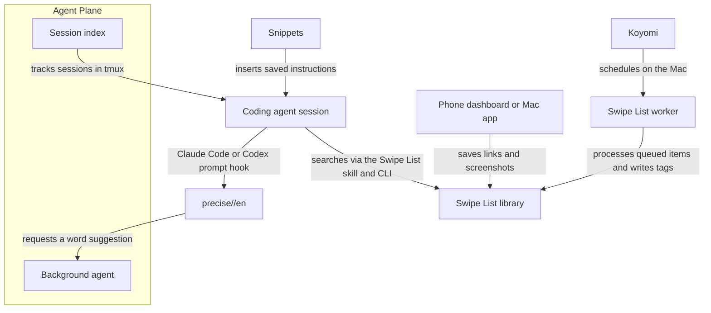
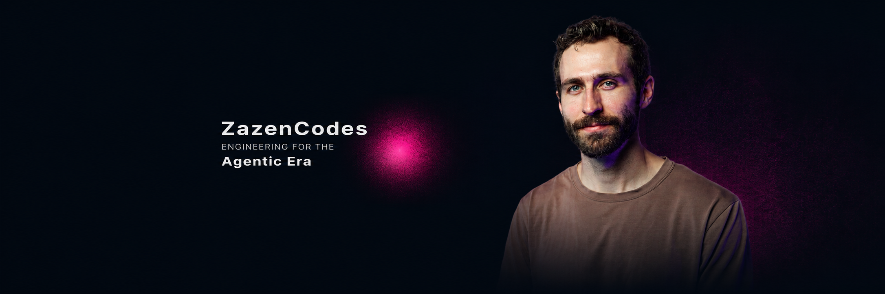

# zstack

<p align="center">
  <a href="LICENSE"></a>
  
  
  <a href="https://zazencodes.com/"></a>
</p>

I’m Alex. This is the stack I use to make videos and run ZazenCodes with coding agents.

## Install zstack

Paste this into Claude Code, Codex or your coding agent of choice.

```text
Set up zstack with me.
Clone https://github.com/zazencodes/zstack to ~/.zstack/zstack.
Then read ~/.zstack/zstack/skills/zstack/SKILL.md and follow its instructions.
```

What happens next:

- Your agent installs the zstack skill in `~/.agents/skills/zstack` and `~/.claude/skills/zstack`.
- The skill only triggers when you say "zstack".
- You pick the skills and extensions you want.
- Later, ask your agent to update or reconfigure zstack.

## How the tools work together



## Extensions

| Extension | What I use it for |
| --- | --- |
| [Agent Plane](extensions/agent-plane.md) | Find and steer my coding agents in tmux. |
| [Snippets](extensions/snippets.md) | Insert instructions I reuse into an agent prompt. |
| [Koyomi](extensions/koyomi.md) | Schedule jobs on the machine that should run them. |
| [precise//en](extensions/precise-en.md) | Learn a more precise word from something I wrote in a prompt. |
| [Swipe List](extensions/swipe-list.md) | Save design references and find them again through my agent. |
| [Motion Studio](extensions/motion-studio.md) | Make 3D system films and narrated explainers for my videos. |

## Skills

To try one, give your coding agent its name. Here’s one you can paste.

```text
Install the tldr skill from zazencodes/skills so I can ask for short summaries.
```

From a terminal, run `npx skills@latest add zazencodes/skills --skill tldr`, substituting the name of the skill you want. You can also install the collection as a Claude Code plugin. [Installation instructions](https://github.com/zazencodes/skills#installation)

| Skill | What it does |
| --- | --- |
| [`adr`](https://github.com/zazencodes/skills/tree/main/skills/adr) | Records decisions as Architecture Decision Records and reads them before changing things. |
| [`ascii-viz`](https://github.com/zazencodes/skills/tree/main/skills/ascii-viz) | Answers with ASCII diagrams and charts where they help. |
| [`codex-image-gen`](https://github.com/zazencodes/skills/tree/main/skills/codex-image-gen) | Generates and edits images using your ChatGPT login. |
| [`diagram-viz`](https://github.com/zazencodes/skills/tree/main/skills/diagram-viz) | Draws diagrams and timelines as images in the ZazenCodes style. |
| [`gemini-web-research`](https://github.com/zazencodes/skills/tree/main/skills/gemini-web-research) | Runs parallel Gemini research jobs and verifies their findings. |
| [`git-commit-conventions`](https://github.com/zazencodes/skills/tree/main/skills/git-commit-conventions) | Makes focused commits with short messages and your git authorship. |
| [`humanizer-tryhard`](https://github.com/zazencodes/skills/tree/main/skills/humanizer-tryhard) | Revises prose in repeated editorial passes until it stops sounding generated. |
| [`init-agents-md`](https://github.com/zazencodes/skills/tree/main/skills/init-agents-md) | Writes a lean, repo-specific `AGENTS.md` and links `CLAUDE.md` to it. |
| [`japanese-only`](https://github.com/zazencodes/skills/tree/main/skills/japanese-only) | Keeps replies in Japanese until you turn it off. |
| [`random-number-generator`](https://github.com/zazencodes/skills/tree/main/skills/random-number-generator) | Generates random numbers, picks, shuffles, samples and secure tokens. |
| [`tavily-text`](https://github.com/zazencodes/skills/tree/main/skills/tavily-text) | Sets headlines in letters that alternate between a pixel font and a serif italic. |
| [`terminal-explainer`](https://github.com/zazencodes/skills/tree/main/skills/terminal-explainer) | Opens illustrated terminal walkthroughs of a change and returns your review feedback. |
| [`tldr`](https://github.com/zazencodes/skills/tree/main/skills/tldr) | Summarizes replies in a few clear bullets. |

## Changelog

See [CHANGELOG.md](CHANGELOG.md). Releases are tagged `vX.Y.Z`.

## License

This guide is published under [GPLv3](LICENSE). The linked projects have their own licenses.

<p align="center">
  <a href="https://zazencodes.com/?utm_source=github&utm_medium=referral&utm_campaign=zstack">
    
  </a>
  <br>
  Created by <a href="https://zazencodes.com/">ZazenCodes</a>
</p>
